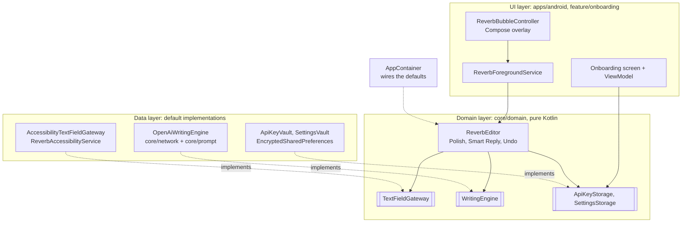

# Reverb

[](https://github.com/vigneshbs33/reverb/actions/workflows/ci.yml)

**Polished text inside any Android app. Type a messy draft, tap a bubble, and it is rewritten right where you typed it.**

Reverb is a floating writing assistant for Android. It works in WhatsApp, Gmail, Slack, notes or any other app with a text box, without a custom keyboard. Under the hood an Accessibility Service reads the focused field when you tap, an LLM rewrites the text in the tone you pick, and Reverb writes the result back into the same field. One tap undoes it.

## Download

[**Download Reverb.apk**](https://github.com/vigneshbs33/reverb/raw/main/releases/Reverb.apk) (Android 10 or newer). Android may show an unknown developer warning because the app is installed outside the Play Store and uses the Accessibility Service; choose **Install anyway**. Reverb has no server: you add your own OpenAI compatible API key inside the app.

## Built with voice for the No Hands: Wispr Challenge

Reverb was built by voice with [Wispr Flow](https://wisprflow.ai) for the WeMakeDevs x Wispr Flow *No Hands* challenge (Builders track). It fixes a problem that voice dictation creates: dictated text is full of filler words, missing punctuation and run-on sentences. The **Clean Speech** tone takes a raw Wispr Flow transcript sitting in any text box and turns it into clean writing in one tap, in the same field, with one tap Undo.

Dictate with Flow, tap the Reverb bubble, pick a tone, done.

## Features

- **Rewrite in place.** Reads the focused text field (or only the part you selected), rewrites it, and replaces it in the same field.
- **Six tones.** Professional, Friendly, Edgy, Promo, Fact Check and Speech, from a small menu on the bubble.
- **Clean Speech for dictation.** Built for voice input: turn a dictated transcript into clean text by removing filler words and fixing punctuation and paragraphs.
- **Fact Check that respects your style.** Fixes spelling, grammar and facts without changing your voice. If nothing needs fixing, Reverb says so and leaves the field alone. When it does fix something, it shows a short reason.
- **Your own voice per tone.** Save a sample of how you write in a tone, and Reverb uses it as a style example for that tone.
- **Smart Reply.** Copy a message you received, tap into your reply box, open Smart Reply on the bubble, and pick Accept, Decline or Clarify. Reverb writes the reply straight into that box, in your voice from your Smart Reply writing sample.
- **One tap Undo.** Restores the whole field as it was before the last rewrite or reply, including the text around a selection.
- **Pause.** A Pause button in the notification hides the bubble and stops all text capture until you resume.
- **Clear errors.** Missing key, invalid key, rate limits, no network, or an app that refuses text changes each show a plain message on the bubble.

## How it works

1. You tap a tone on the floating bubble.
2. `ReverbForegroundService` hands the action to `ReverbEditor`, which reads the focused field through a `TextFieldGateway` (on Android, the accessibility service). It works on the selection, or on the whole field when nothing is selected.
3. A `WritingEngine` rewrites the text. The default, `OpenAiWritingEngine`, calls an OpenAI compatible Chat Completions API with a tone prompt from `ReverbPromptFactory` and your writing sample for that tone.
4. The editor writes the result back into the same field and keeps a snapshot of the whole field, with its selection, so Undo can restore it exactly.

## Architecture

Reverb has three layers. The middle one, `core/domain`, is plain Kotlin with no Android code: it holds the editing logic and the interfaces every other part plugs into. That is what makes the parts swappable and the logic testable on the JVM.



| Module | Layer | What it holds |
|---|---|---|
| `core/domain` | Domain | `ReverbEditor`, `FieldSnapshot`, and the `TextFieldGateway`, `WritingEngine` and storage interfaces. Pure Kotlin. |
| `core/model` | Domain | Shared types such as `ReverbTone`. Pure Kotlin. |
| `core/prompt` | Data | Tone prompts for rewrites and replies. Pure Kotlin. |
| `core/network` | Data | `OpenAiWritingEngine`: Retrofit and OkHttp client, Fact Check JSON parsing. Pure Kotlin. |
| `core/designsystem` | UI | Compose theme. |
| `feature/onboarding` | UI | Setup and settings screens. |
| `apps/android` | UI + Android data | Accessibility service, foreground service, bubble overlay, encrypted vaults and `AppContainer`. |

| Component | Role |
|---|---|
| `ReverbEditor` | Runs Polish, Smart Reply and Undo against any field and engine. Serialises actions and exposes `canUndo` as a `StateFlow`. Returns a typed `EditResult` instead of throwing. |
| `AppContainer` | Manual dependency injection. Builds each default once; the one place to swap an implementation. |
| `ReverbAccessibilityService` | Reads and replaces text in the focused field, only when asked. Ignores password fields. Does no work on accessibility events. |
| `ReverbForegroundService` | Keeps the bubble alive, runs editor actions off the main thread and shows the result on the bubble. |
| `ReverbBubbleController` | The snap to edge bubble, tone menu, Smart Reply menu and status states, drawn with Compose in a `WindowManager` overlay. |
| `GhostClipboardActivity` | An invisible activity that takes focus for a moment, because Android 10+ only lets the focused app read the clipboard. This is what makes Smart Reply work. |
| `ApiKeyVault`, `SettingsVault` | Store the API key and your tone samples with `EncryptedSharedPreferences` (Android Keystore, AES-256). |

## Integrate Reverb's engine in your app

`core/domain` and `core/network` are plain Kotlin modules, so they work in any Android or JVM app. Add them as Gradle modules, implement `TextFieldGateway` for your text field (see [Extending](#extending)), then:

```kotlin
val editor = ReverbEditor(
    field = EditTextGateway(editText),
    engine = OpenAiWritingEngine(
        config = OpenAiConfig(model = "gpt-4o-mini"),
        apiKeyProvider = { secureStore.openAiKey() },
    ),
    settings = InMemorySettingsStorage(),
)

scope.launch {
    when (val result = editor.polish(ReverbTone.FRIENDLY)) {
        is EditResult.Applied -> showPreview(result.preview)
        is EditResult.Failed -> showError(result.error)
        else -> Unit
    }
}
```

`editor.reply(ReverbTone.PROFESSIONAL, incomingMessage)` writes a Smart Reply into the field, and `editor.undo()` puts the field back as it was.

## Extending

**Use your own model.** Implement `WritingEngine` and return it from `AppContainer.writingEngine`. Nothing else changes.

```kotlin
class MyEngine(private val llm: MyLlmClient) : WritingEngine {
    override suspend fun rewrite(request: RewriteRequest): RewriteResult =
        RewriteResult.Rewritten(llm.complete(tone = request.tone.title, style = request.styleSample, text = request.text))

    override suspend fun reply(request: ReplyRequest): String =
        llm.reply(request.message, style = request.styleSample)
}
```

Throw `WritingEngineException` with the HTTP status for provider errors, and the bubble shows the right message (invalid key, rate limit, network).

**Point the default engine at another server.** Any OpenAI compatible endpoint works. Set it in `gradle.properties`, `~/.gradle/gradle.properties` or on the command line:

```bash
./gradlew :apps:android:assembleDebug -Preverb.llm.baseUrl=https://llm.example.com/ -Preverb.llm.model=my-model
```

The values are compiled into `BuildConfig`. API keys never go in Gradle files: users enter their own key in the app and it stays encrypted on the device.

**Use another text surface.** Implement `TextFieldGateway` for a keyboard, an in app editor or a desktop client. For a plain `EditText`:

```kotlin
class EditTextGateway(private val editText: EditText) : TextFieldGateway {
    override val isAvailable = true
    override fun read() = FieldSnapshot(editText.text.toString(), editText.selectionStart, editText.selectionEnd)
    override fun write(snapshot: FieldSnapshot): Boolean {
        editText.setText(snapshot.text)
        snapshot.selectionRange?.let { editText.setSelection(it.first, it.last + 1) }
        return true
    }
}
```

**Store data elsewhere.** Implement `ApiKeyStorage` or `SettingsStorage` (for example backed by your account system) and return it from `AppContainer`.

**Add a tone.** Add it to `ReverbTone`, give it a prompt in `ReverbPromptFactory` (the compiler points out every `when` that needs it), and add a button to the tone menu in `ReverbBubbleController`.

## Testing and CI

```bash
./gradlew test                                      # all unit tests, no emulator needed
ktlint --relative "**/*.kt" "**/*.kts"              # style check (ktlint 1.3.1, rules in .editorconfig)
./gradlew :apps:android:connectedDebugAndroidTest   # UI test on a device or emulator
```

Unit tests cover the editor (Polish, Smart Reply, Undo, every error path) with fakes for the field and the engine, field snapshots and selections, writing sample choice, prompt building, Fact Check parsing, the OpenAI engine against `MockWebServer`, and the bubble's error messages. GitHub Actions runs ktlint, the unit tests and a debug build on every push and pull request.

## Try it

1. Install the APK from the Download link above.
2. Open Reverb and paste your OpenAI API key.
3. Grant **Display over other apps**, then turn Reverb on under **Settings > Accessibility > Reverb**.
4. Open any app, type something messy in a text field, tap the Reverb bubble and pick a tone.
5. Not happy with it? Tap the bubble again and hit Undo.

## Privacy

- There is no Reverb server. Text goes from your phone straight to the OpenAI API with your own key, and only when you tap.
- Reverb reads only the field in focus, only on a tap. It skips password fields, and Pause turns capture off completely.
- Your API key is encrypted on the device with the Android Keystore (AES-256).
- Debug logs record only text length, never the text itself.

## Build from source

Requirements: Android Studio (or the Android SDK with platform 35) and JDK 17.

```bash
git clone https://github.com/vigneshbs33/reverb.git
cd reverb
cp local.properties.example local.properties   # set sdk.dir to your Android SDK
./gradlew :apps:android:assembleDebug
```

The APK is written to `apps/android/build/outputs/apk/debug/`.

## Tech stack

- Kotlin, Jetpack Compose (Material 3)
- Android Accessibility Service and a `WindowManager` overlay
- Kotlin Coroutines and Flow
- Retrofit, OkHttp and Gson for the OpenAI API
- AndroidX Security Crypto (`EncryptedSharedPreferences`)
- JUnit 4, kotlinx-coroutines-test and OkHttp MockWebServer for tests
- ktlint and GitHub Actions
- Gradle Kotlin DSL with a version catalog, min SDK 29, target SDK 35

## Project structure

```
apps/android          App: accessibility service, foreground service, bubble overlay, vaults, AppContainer
feature/onboarding    Setup and settings screens (Compose)
core/domain           ReverbEditor and the engine, field and storage interfaces (pure Kotlin)
core/network          OpenAiWritingEngine, the default engine (pure Kotlin)
core/prompt           Tone prompts for rewrites and replies (pure Kotlin)
core/model            Shared types such as ReverbTone (pure Kotlin)
core/designsystem     Theme
Context_MD            Early product and design notes
```

## Limits

- Some apps draw their own text views and ignore `ACTION_SET_TEXT`. Reverb then shows "Could not replace text in this app" instead of failing silently.
- Rewriting needs a network connection and an OpenAI API key.

## Roadmap

- Rewrite length control (shorter, similar, longer) in the bubble. The prompt side already supports it.
- Pass the current app as context to the prompt. The prompt factory already accepts it.
- More engines out of the box: other providers and on device models (the `WritingEngine` interface is ready for them).
- Windows version with a global hotkey (see `Context_MD/Plan_MD/windows_implementation.md`).

## Contributing

Issues and pull requests are welcome. See [CONTRIBUTING.md](CONTRIBUTING.md) and the [CHANGELOG](CHANGELOG.md).

## License

MIT, see [LICENSE](LICENSE).

Built by Vignesh B S ([@vigneshbs33](https://github.com/vigneshbs33)).
